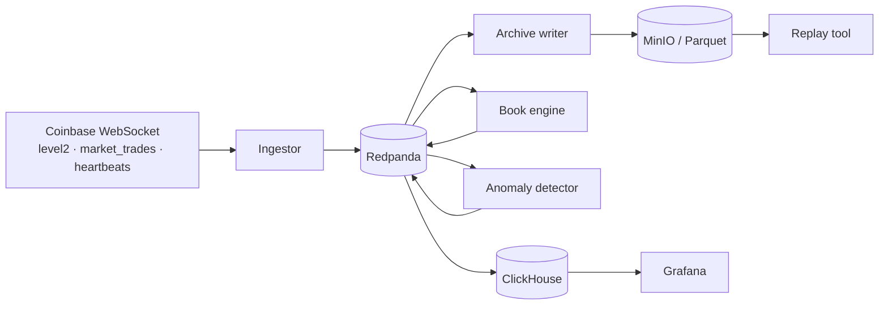

# Coinbase Order Book Stream

Real-time pipeline that rebuilds Coinbase Level 2 order books from the live WebSocket feed, computes market-microstructure features, and flags anomalies as they happen. Every raw event is archived, so any book can be replayed and rebuilt exactly as it stood at any past moment.

> **Status:** in progress. Message bus is running; ingestor is next.

## Architecture



1. **Ingest:** subscribe to Coinbase's unauthenticated Level 2 and trade channels, keyed by `product_id`.
2. **Rebuild:** apply snapshot and update events to an in-memory book per product, detecting sequence gaps and resyncing.
3. **Featurize:** emit spread, mid, depth, imbalance, and microprice.
4. **Detect:** flag liquidity withdrawals, price jumps, spoofing-like behavior, and data-quality issues (crossed books, gaps, stale feeds).
5. **Serve and replay:** live dashboards in Grafana; deterministic book reconstruction from the Parquet archive.

## Tech stack

Python 3.12 (asyncio) · Redpanda (Kafka API) · MinIO + Parquet · ClickHouse · Grafana · Prometheus · Dagster · dbt · Docker Compose · GitHub Actions

## Topics

| Topic | Partitions | Retention | Contents |
|---|---|---|---|
| `coinbase.l2.raw` | 6 | 7 days | Raw Level 2 messages |
| `coinbase.trades.raw` | 6 | 7 days | Raw trade messages |
| `book.features` | 6 | 3 days | Derived book features |
| `anomalies` | 1 | default | Scored alerts |

## Quickstart

```bash
docker compose up -d                  # Redpanda, topic setup, console
docker compose logs topics-init       # confirm topics were created
open http://localhost:8080            # Redpanda Console
```

Host code connects to Kafka at `localhost:19092`; services inside Compose use `redpanda:9092`.

## Roadmap

- [x] Message bus (Redpanda) and topics
- [ ] WebSocket ingestor
- [ ] Parquet archive to MinIO
- [ ] Order book engine with gap handling and tests
- [ ] Book validation against the REST product book
- [ ] Feature stream, ClickHouse sink, Grafana dashboard
- [ ] Rule-based and data-quality anomaly detection
- [ ] Pipeline metrics (lag, throughput, latency)
- [ ] Replay tool with golden tests
- [ ] Dagster jobs and dbt models
- [ ] Optional: ML detector, PyFlink, Iceberg, AWS deploy
